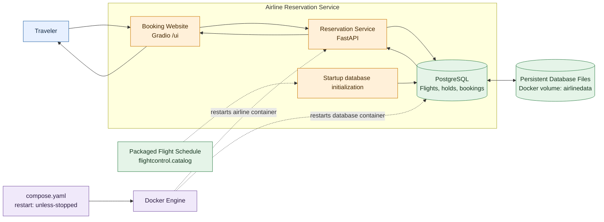

# Airline Reservation System Data Flow

## System Overview

This high-level view shows the traveler-facing booking flow and the airline's
database, schedule input, and persistence.

### Diagram key

- **Blue — traveler:** The person using the booking website.
- **Orange — application processes:** The website handlers, reservation API,
  and startup initialization.
- **Green — data:** The schedule, PostgreSQL records, and persistent database
  files.
- **Purple — container management:** Compose configures restart policies;
  Docker applies them to the airline and database containers.

## Appendix: Reservation Flow

This implementation-level view follows a booking request through the airline
application to PostgreSQL and persistent storage.

```mermaid
flowchart LR
    traveler["Traveler<br/>Browser UI"]

    subgraph app["Airline application container"]
        gradio["Gradio mount<br/>/ui"]
        fastapi["FastAPI API"]
        catalog["Catalog and itinerary logic"]
        locking["Reservation transactions<br/>and seat availability"]
    end

    subgraph dbcontainer["PostgreSQL database container"]
        postgres[("PostgreSQL 17")]
        wal["Write-ahead log<br/>and database pages"]
    end

    volume[("Named volume<br/>airlinedata")]

    traveler -->|"Trip and booking actions"| gradio
    gradio -->|"Internal HTTP API requests"| fastapi
    fastapi -->|"Booking results"| gradio
    gradio -->|"Confirmation or cancellation result"| traveler
    fastapi -->|"Search and itinerary rules"| catalog
    catalog -->|"Flight and itinerary data"| fastapi
    fastapi -->|"Hold and booking operations"| locking
    locking -->|"Locks and SQL transactions"| postgres
    postgres -->|"Stored booking and seat data"| locking
    locking -->|"Result"| fastapi
    postgres -->|"Durable commits"| wal
    wal -->|"Persistent files"| volume
```

### Database contents

- **Flights:** Schedule, route, capacity, and fare information.
- **Holds and hold legs:** Temporary reservations, expiration times, and the flights reserved by each hold.
- **Bookings and booking legs:** Confirmed or cancelled purchases, passenger information, and the flights in each booking.
- **Request records:** Booking request keys and saved replies, used to handle retries safely.
- **Service state:** Restart timing information.

### Reservation flow

1. The traveler uses the website, which sends the booking request to the airline service.
2. For a hold or booking, the service opens a database transaction and locks the relevant flight rows in a consistent order.
3. PostgreSQL calculates seats already sold and seats still held. The service proceeds only if all itinerary legs have enough capacity.
4. The service writes all legs and the hold or booking status in the same transaction. PostgreSQL commits the full change or rolls it all back.
5. The service returns the result through the website to the traveler.
6. If the airline process exits, Docker may restart its container according to the policy configured in Compose. PostgreSQL and its persistent volume are separate, so committed booking data remains.

## Refined DFD: Physical and Digital Elements

### Updated diagram

The diagram shows the traveler-facing browser, the airline application
container, PostgreSQL, persistent database storage, and the startup and
container-restart inputs. The airline application serves both the Gradio
booking interface and the FastAPI reservation API.

```mermaid
flowchart LR
    traveler["Traveler<br/>Human user"]
    browser["Web browser<br/>Gradio frontend at /ui"]

    subgraph airline["Airline application container<br/>Compose service: airline"]
        ui["Gradio UI handlers"]
        api["FastAPI API<br/>Reservation logic"]
        startup["Startup initialization<br/>initialize_database() / seed_catalog()"]
        catalog["Packaged catalog module<br/>flightcontrol.catalog<br/>fixed seed: 4340"]
    end

    subgraph postgres_service["PostgreSQL container<br/>Compose service: db"]
        database[("PostgreSQL 17<br/>flights, holds, bookings,<br/>passengers, request records")]
    end

    volume[("Docker named volume<br/>airlinedata<br/>persistent database files")]
    compose["compose.yaml<br/>restart: unless-stopped"]
    docker["Docker Engine<br/>applies container restart policies"]

    traveler -->|"uses"| browser
    browser -->|"Gradio UI events over HTTP"| ui
    ui -->|"internal HTTP requests to 127.0.0.1:8080"| api
    api -->|"SQL reads and transactions"| database
    database -->|"query results"| api
    api -->|"UI operation results"| ui
    ui -->|"renders results"| browser

    catalog -->|"catalog.get() during startup"| startup
    startup -->|"creates schema and copies schedule into flights"| database

    database <-->|"PostgreSQL data directory<br/>/var/lib/postgresql/data"| volume

    compose -->|"configures policies for airline and db"| docker
    docker -.->|"restarts exited airline container"| airline
    docker -.->|"restarts exited database container"| postgres_service

    classDef person fill:#e7f0ff,stroke:#2864a5,color:#142b45
    classDef frontend fill:#dceeff,stroke:#2864a5,color:#142b45
    classDef backend fill:#fff0d9,stroke:#c87500,color:#422600
    classDef dbElement fill:#e5f4e8,stroke:#32804a,color:#16351f
    classDef storage fill:#def4f0,stroke:#258074,color:#123b36
    classDef packaged fill:#f0e9fa,stroke:#7650a1,color:#2c1e42
    classDef operations fill:#f1f2f4,stroke:#626b75,color:#252a30

    class traveler person
    class browser frontend
    class ui,api,startup backend
    class database dbElement
    class volume storage
    class catalog packaged
    class compose,docker operations

    style airline fill:#fffaf0,stroke:#c87500,stroke-width:1px
    style postgres_service fill:#f4fbf5,stroke:#32804a,stroke-width:1px
```

### Legend

| Color / element | Type | Meaning |
|---|---|---|
| Light blue person | Human user | The traveler using the service |
| Blue browser | Web browser / frontend | The Gradio interface displayed at `/ui` |
| Orange process | Digital backend | Gradio server handlers, FastAPI routes, and startup initialization |
| Green cylinder | Database | PostgreSQL tables used by the airline |
| Teal cylinder | Database storage | The Docker-managed `airlinedata` volume mounted to PostgreSQL's data directory; its files persist on the host |
| Purple component | Packaged digital input | The deterministic catalog generator included with the application |
| Gray component | Deployment configuration/runtime | Compose configuration and the Docker Engine that applies restart policies |

Solid arrows show user, application, or data flow. Dashed arrows show
container-management behavior.

### Schedule and database startup

The flight schedule is generated by the packaged Python module
`flightcontrol.catalog` in `src/flightcontrol/catalog.py`; it is not read from
an external website or a separately mounted schedule file. The catalog uses
fixed seed `4340`, so the generated schedule is consistent.

When the airline application starts, its database initialization creates the
schema and calls `seed_catalog()`. That function gets the generated catalog
and copies its flight rows into PostgreSQL's `flights` table if the table is
empty. An already populated catalog is left in place.

### Restart policy and persistent database storage

The `restart: unless-stopped` settings come from `compose.yaml`. They are
configured separately on the `airline` and `db` services, and Docker applies
each policy to its corresponding container when that container exits. For
example, when the airline process exits, Docker can restart the airline
container; if the PostgreSQL container exits, its own policy can restart that
container.

The restart policy acts on containers, not on database rows or files. The
PostgreSQL container stores its data directory at
`/var/lib/postgresql/data`, which Compose mounts from the named `airlinedata`
volume. That volume preserves committed database files across container
restarts. Restarting the airline container does not itself restart PostgreSQL
or erase the volume.

### Reservation data

PostgreSQL stores the flight catalog, active and completed holds, hold legs,
bookings, booking legs, passenger information, idempotency records, and
service state. Reservation changes use database transactions and row locks so
that a multi-flight hold or booking is committed in full or not at all.
