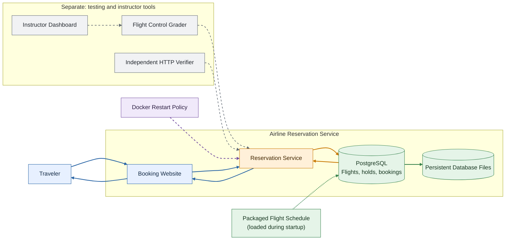
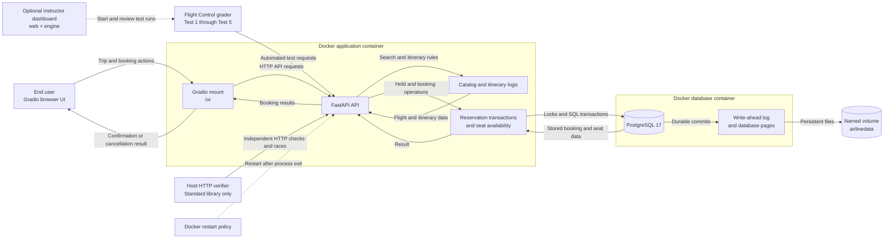

# Airline Reservation System Data Flow

## System Overview

This view shows the main people, processes, and database decisions without
requiring the reader to know the project files or endpoint names.



### Diagram key

- **Blue — traveler actions:** Search, hold seats, book, and cancel.
- **Orange — reservation decisions:** The service checks available seats and processes reservations.
- **Green — stored data:** PostgreSQL records and the persistent files that retain them.
- **Purple — recovery:** Docker restarts the airline service after its process exits; the database storage remains.
- **Gray dashed — testing and instruction:** These tools call the service separately from the traveler's website. The instructor dashboard can start and review grader runs.

The flight schedule is supporting input loaded into PostgreSQL when the service
starts. It is not part of the traveler's booking flow. PostgreSQL uses its
write-ahead log when committing changes; the high-level view groups those
internal database details under the database and persistent storage.

## Appendix: Detailed Data Flow

This view is for readers who want the implementation-level boundaries and
interactions.


```mermaid
flowchart LR
    traveler["Traveler"]
    subgraph airline["Airline Reservation Service"]
        website["Booking Website"]
        service["Reservation Service"]
        database[("PostgreSQL<br/>Flights, holds, bookings")]
        disk[("Persistent Database Files")]
    end

    

    catalog["Packaged Flight Schedule<br/>(loaded during startup)"]
    docker["Docker Restart Policy"]

    traveler --> website
    website --> service
    service --> website
    website --> traveler

    service --> database
    database --> service
    catalog -.-> database
    database --> disk
    docker -.-> service

    

    classDef user fill:#e7f0ff,stroke:#2864a5,color:#142b45
    classDef process fill:#fff0d9,stroke:#c87500,color:#422600
    classDef data fill:#e5f4e8,stroke:#32804a,color:#16351f
    classDef recovery fill:#f0e9fa,stroke:#7650a1,color:#2c1e42
    classDef test fill:#f1f2f4,stroke:#626b75,color:#252a30

    class traveler,website user
    class service process
    class database,disk,catalog data
    class docker recovery
    class instructor,grader,verifier test

    linkStyle 0,1,2,3 stroke:#2864a5,stroke-width:2px
    linkStyle 4,5 stroke:#c87500,stroke-width:2px
    linkStyle 6,7 stroke:#32804a,stroke-width:2px
    linkStyle 8 stroke:#7650a1,stroke-width:2px,stroke-dasharray:5 5
    linkStyle 9,10,11 stroke:#626b75,stroke-width:1.5px,stroke-dasharray:5 5
```




### Database contents

- **Flights:** Schedule, route, capacity, and fare information.
- **Holds:** Temporary reservations and expiration times.
- **Hold legs:** The flights reserved by each hold.
- **Bookings:** Confirmed and cancelled purchases and passenger information.
- **Booking legs:** The flights included in each booking.
- **Request records:** Booking request keys and saved replies, used to safely handle retries.
- **Service state:** Restart timing information.

### Reservation flow

1. The website, grader, or independent verifier sends an HTTP request to the airline service.
2. For a hold or booking, the service opens a database transaction and locks the relevant flight rows in a consistent order.
3. PostgreSQL calculates seats already sold and seats still held. The service only proceeds if all legs have enough capacity.
4. The service writes all legs and the hold or booking status in the same transaction. PostgreSQL commits the full change or rolls it all back.
5. The service returns a result over HTTP. The grader and independent verifier test through this same outside interface; they do not inspect application internals.
6. On an application-process failure, Docker restarts the service. PostgreSQL and its persistent volume are separate, so committed booking data remains.
