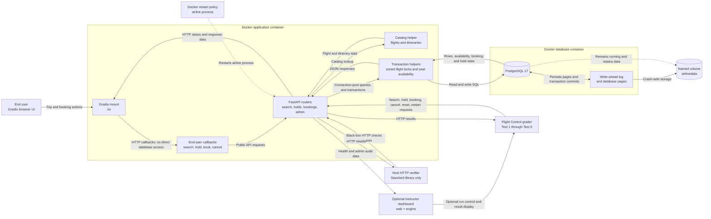

# Airline Reservation System Data Flow

## Data Stores

- **PostgreSQL `flights`** stores the seeded airline catalog, including capacity and scheduled-leg information.
- **PostgreSQL `holds`** stores temporary seat reservations and their absolute expiration times.
- **PostgreSQL `hold_flights`** connects each hold to every flight leg it reserves.
- **PostgreSQL `bookings`** stores confirmed and cancelled bookings and passenger information.
- **PostgreSQL `booking_flights`** connects confirmed or cancelled bookings to flight legs and passenger counts.
- **PostgreSQL `idempotency_keys`** stores request bodies and original responses for duplicate booking requests.
- **PostgreSQL `service_state`** records restart timing used during application recovery.
- **Docker `airlinedata` volume** keeps the PostgreSQL data files across application and container restarts.

## Important Concurrency and Test Flows

1. The end user or grader sends an HTTP request to a FastAPI endpoint.
2. Hold and booking operations obtain a PostgreSQL transaction and lock every involved flight row in sorted flight-ID order.
3. SQL aggregates active holds and confirmed bookings to calculate seats sold, seats held, and seats available.
4. The transaction commits the seat change and all of its associated rows together, or rolls the whole operation back.
5. Flight Control and the independent host verifier test through HTTP only. They do not import the airline implementation or read PostgreSQL directly.
6. The restart endpoint causes the airline process to exit; Docker restarts the process while PostgreSQL and the named data volume remain available.
